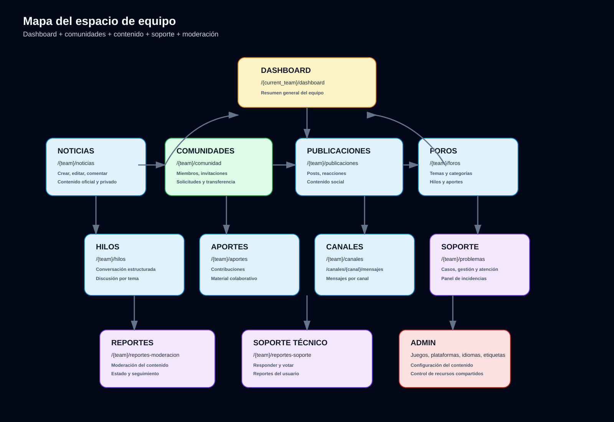

# Mapa de navegación completo — Nexus Community

Este documento resume la navegación global del proyecto, distinguiendo entre:

- Portada pública e invitado
- Autenticación y configuración de cuenta
- Dashboard y módulos del equipo
- Herramientas sociales y de soporte
- API opcional de directorio de comunidades

## 1. Vista general del sistema

Nexus Community combina un frontend Laravel + Blade + Livewire + Flux y un módulo opcional de directorio de comunidades en TypeScript/Prisma.

La app principal está organizada así:

- Public landing: `/`
- Auth flow: `/login`, `/register`, `/settings/*`
- Team area: `/{current_team}/*`
- Social features: chat, amistades, notificaciones, asistente
- Content modules: noticias, comunidades, foros, publicaciones, canales, reportes


## 2. Navegación pública

### Rutas principales

| Ruta | Nombre | Descripción |
|---|---|---|
| `/` | `home` | Landing principal con noticias oficiales, CTA e información general |
| `/noticias-publicas` | `public-noticias.index` | Listado público de noticias |
| `/noticias-oficiales/refresh` | `official-news.refresh` | Refresca noticias oficiales |
| `/comunidad-publica` | `public-comunidad.index` | Catálogo público de comunidades |
| `/soporte-publico` | `public-problemas.index` | Soporte público |
| `/chatbot` | `chatbot.index` | Chat con asistente (solo autenticado) |

### Flujo principal del visitante

- Visita la landing pública y puede navegar por noticias oficiales y comunidades públicas.
- Si intenta interactuar (comentar, solicitar ingreso, publicar, chatear), el sistema le exige autenticación y verificación.
- El layout público se encuentra en `resources/views/nexus_community.blade.php` y el controlador principal en `app/Http/Controllers/PublicNewsController.php`.

## 3. Autenticación y cuenta

### Auth

| Ruta | Propósito |
|---|---|
| `/login` | Inicio de sesión |
| `/register` | Registro |
| `/logout` | Cierre de sesión |
| `/forgot-password` | Recuperación |
| `/reset-password/{token}` | Reinicio |
| `/email/verify` | Verificación |
| `/user/confirm-password` | Confirmación de contraseña |

### Configuración

Las rutas de configuración se registran en `routes/settings.php`:

| Ruta | Nombre | Descripción |
|---|---|---|
| `/settings` | redirección | Va a `/settings/profile` |
| `/settings/profile` | `profile.edit` | Perfil del usuario |
| `/settings/appearance` | `appearance.edit` | Apariencia visual |
| `/settings/security` | `security.edit` | Contraseña, 2FA, passkeys |
| `/settings/teams` | `teams.index` | Gestión de equipos |
| `/settings/teams/{team}` | `teams.edit` | Edición de equipo |
| `/settings/communities` | `communities.settings` | Comunidades del usuario |
| `/.well-known/passkey-endpoints` | `well-known.passkeys` | Endpoints WebAuthn |

## 4. Navegación por equipo

El espacio principal del equipo se activa con el prefijo `/{current_team}` y exige:

- autenticación
- email verificado
- `SetTeamUrlDefaults`
- `EnsureTeamMembership`



### Dashboard

| Ruta | Nombre | Vista/Controlador |
|---|---|---|
| `/{current_team}/dashboard` | `dashboard` | `HomeController@index` → `resources/views/dashboard.blade.php` |

Funcionalidad:
- resumen de noticias del equipo
- métricas de comunidades, soporte y contenido
- notificaciones recientes
- enlaces rápidos a módulos principales

### Módulos del equipo

| Módulo | Rutas principales | Descripción |
|---|---|---|
| Noticias | `/{team}/noticias` | Crear, listar, comentar y moderar noticias |
| Comunidades | `/{team}/comunidad` | Crear y administrar comunidades del equipo |
| Problemas | `/{team}/problemas` | Reportes, seguimiento y atención |
| Publicaciones | `/{team}/publicaciones` | Posts sociales y reacciones |
| Foros | `/{team}/foros` | Temas generales |
| Hilos | `/{team}/hilos` | Discusión por hilo |
| Aportes | `/{team}/aportes` | Contribuciones o material |
| Canales | `/{team}/canales` y `/canales/{canal}/mensajes` | Mensajería por canal |
| Juegos | `/{team}/juegos` | Catalogación de juegos |
| Plataformas | `/{team}/plataformas` | Plataformas de juego |
| Idiomas | `/{team}/idiomas` | Idiomas soportados |
| Etiquetas | `/{team}/etiquetas` | Etiquetado de contenido |
| Reportes moderación | `/{team}/reportes-moderacion` | Incidencias moderación |
| Reportes soporte | `/{team}/reportes-soporte` | Soporte y votación |

## 5. Social y comunicación

Módulos no estrictamente de contenido, pero muy centrales en la experiencia:

| Ruta | Nombre | Descripción |
|---|---|---|
| `/chatbot` | `chatbot.index` | Asistente interno |
| `/chat/{recipient}` | `chat.show` | Chat privado ligado a usuario |
| `/amistades` | `amistades.index` | Gestión de amistades |
| `/notificaciones` | `notificaciones.index` | Panel de notificaciones |

Estos módulos están protegidos por `auth` y `verified` y forman parte del “espacio social” del usuario.

## 6. Estructura de archivos clave

### Backend

- `app/Http/Controllers/` → controladores del negocio y de navegación
- `app/Models/` → entidades Eloquent (`Comunidad`, `noticias`, `Problemas`, etc.)
- `app/Policies/` → reglas de acceso
- `routes/web.php` → enrutado principal
- `routes/settings.php` → rutas de perfil y configuración

### Frontend

- `resources/views/` → páginas Blade, layouts y componentes
- `resources/views/nexus_community.blade.php` → landing pública
- `resources/views/dashboard.blade.php` → dashboard del equipo
- `resources/views/pages/auth/*.blade.php` → vistas de autenticación y módulos sociales
- `resources/views/layouts/*.blade.php` → layouts globales

### Opcional: directorio de comunidades

Proyecto independiente en:

- `community-directory/`
- `community-directory/src/`
- `community-directory/prisma/`

Es un API TypeScript + Prisma para gestión de directorios de comunidades; no es requisito principal para el funcionamiento de Laravel.

## 7. Mapa funcional resumido

```text
Visitor / Guest
  ├─ Home (/)
  ├─ Noticias públicas (/noticias-publicas)
  ├─ Comunidades públicas (/comunidad-publica)
  └─ Soporte público (/soporte-publico)

Authenticated User
  ├─ Login / Register / Recover / Verify Email
  ├─ Settings (/settings/*)
  ├─ Chatbot / Chat privado / Amistades / Notificaciones
  └─ Team dashboard (/{team}/dashboard)

Team Context
  ├─ Noticias
  ├─ Comunidades
  ├─ Problemas
  ├─ Publicaciones
  ├─ Foros / Hilos / Aportes / Canales
  ├─ Juegos / Plataformas / Idiomas / Etiquetas
  ├─ Reportes de moderación y soporte
  └─ Team management
```

## 8. Mapa recomendado para entender el proyecto

Si quieres navegarlo mentalmente, sigue este orden:

1. `routes/web.php` → rutas globales
2. `routes/settings.php` → perfil y equipos
3. `resources/views/nexus_community.blade.php` → landing pública
4. `resources/views/dashboard.blade.php` → dashboard del equipo
5. `app/Http/Controllers/` → controladores por módulo
6. `app/Models/` → entidades y relación con DB
7. `resources/views/pages/` → vistas detalladas de cada módulo

## 9. Enlaces clave del repositorio

- [README.md](../README.md)
- [docs/funcionalidades.md](./funcionalidades.md)
- [docs/informe-proyecto.md](./informe-proyecto.md)
- [routes/web.php](../routes/web.php)
- [routes/settings.php](../routes/settings.php)
- [resources/views/nexus_community.blade.php](../resources/views/nexus_community.blade.php)
- [resources/views/dashboard.blade.php](../resources/views/dashboard.blade.php)
- [app/Http/Controllers/HomeController.php](../app/Http/Controllers/HomeController.php)

## 10. Conclusión

El proyecto tiene una arquitectura clara en capas:

- Frontend público para usuarios no autenticados
- Frontend autenticado para cuenta, seguridad y equipos
- Dashboard por equipo con módulos sociales y de contenido
- Relación de permisos y roles por equipo
- Un directorio opcional separado para comunidades

La aplicación principal está diseñada como una red social de gaming organizada por equipos, con navegación jerárquica y módulos funcionales muy definidos.
